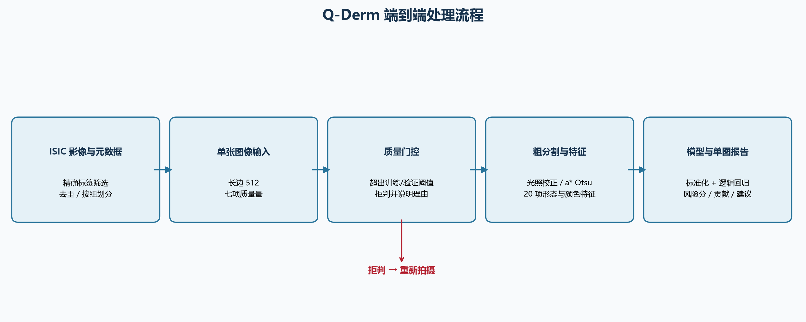
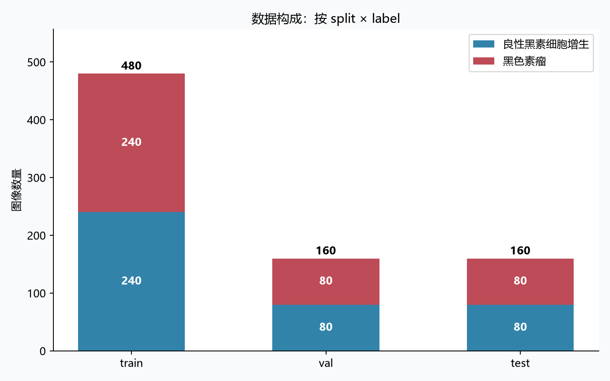
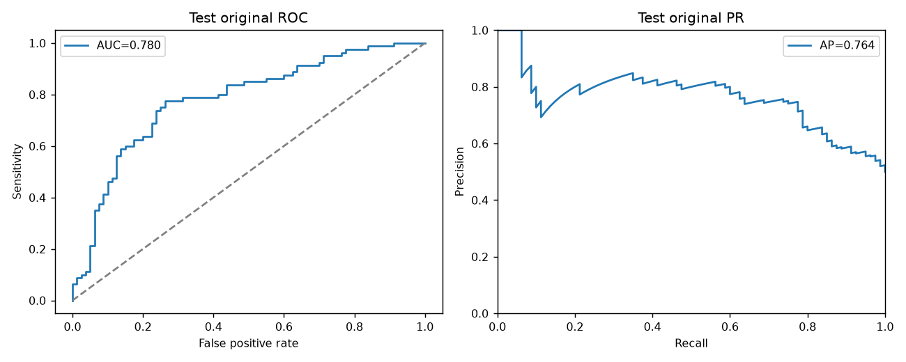
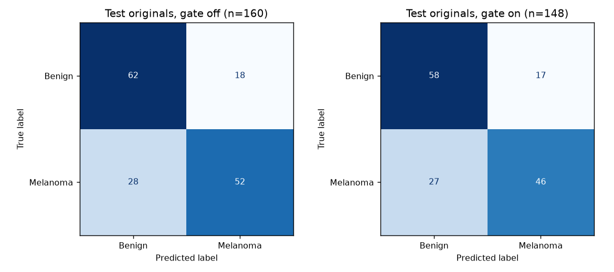
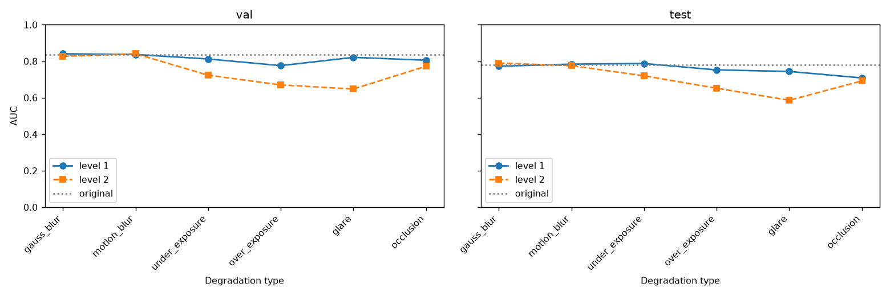
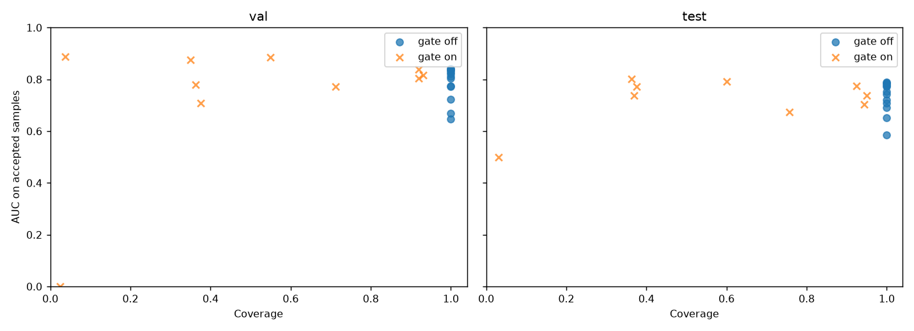
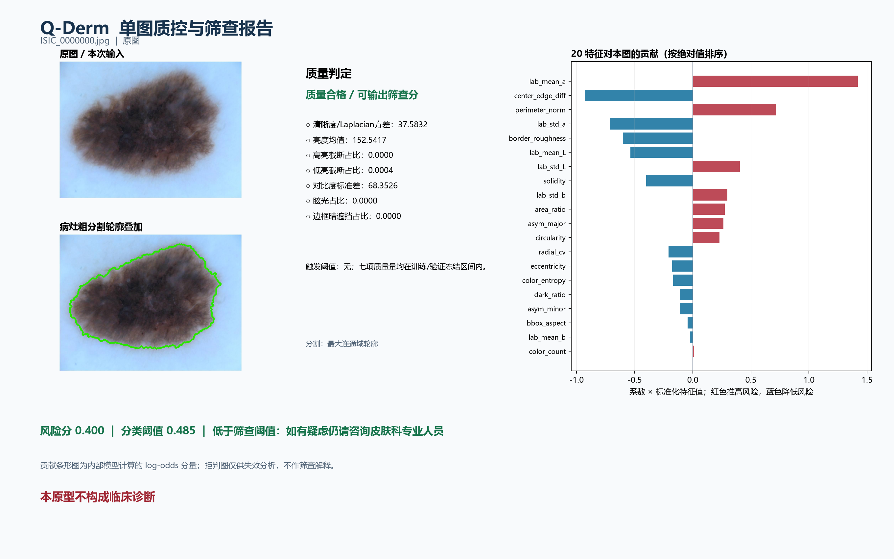
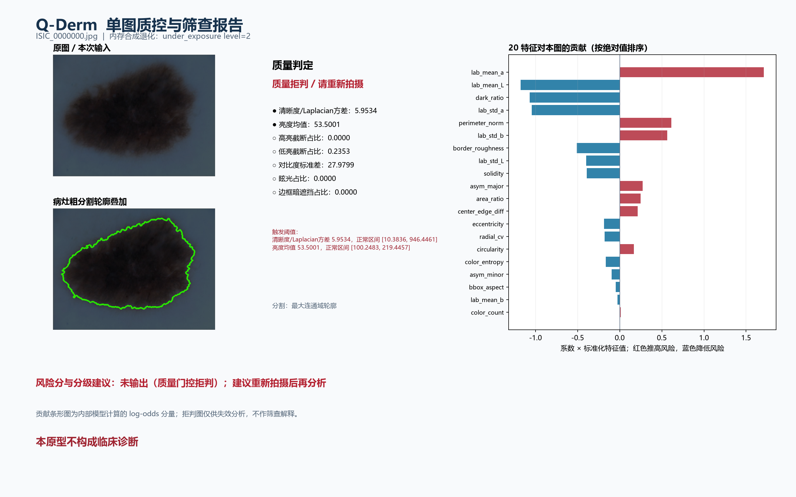

# Q-Derm 技术报告

**项目：**质控驱动的皮肤镜病灶筛查（Q-Derm）  
**日期：**2026 年 10 月 7 日

## 一、作品概述

### 1.1 背景介绍

皮肤镜影像可用于色素性病灶的观察，公开影像库为算法研究提供了可复核的材料。已有 HAM10000 与 ISIC 挑战工作展示了此类数据的研究价值[3–4]。然而，图像失焦、曝光异常、眩光与遮挡可能使病灶分割和后续分类失效。仅给出分类分数，无法说明输入是否适合模型处理，也难以让使用者核查模型依赖了哪些图像属性。

Q-Derm 将质量门控放在风险输出之前：若质量量越过冻结阈值，就拒绝输出筛查建议并说明原因；若接受，则展示病灶粗分割轮廓、特征贡献、风险分和分级建议。它是公开数据上的研究原型，本原型不构成临床诊断。

### 1.2 目标定位

作品针对 ISIC 元数据中两类精确标签，构建“采集与溯源—质量检测—粗分割—可解释特征—二分类—单图报告”的可复现流水线。方案要求在留出测试集报告分类性能、覆盖率与拒判率，并以门控开关和合成退化检验失效行为。目标是验证质量控制与解释展示的工程可行性，而非证明临床诊断效能。未获得医疗机构实测数据，因此不声称经济收益。

## 二、需求分析与应用场景

### 2.1 问题剖析

第一，公开影像的清晰度、光照及遮挡分布不一；坏图强行输出风险分会掩盖输入失效。第二，分割无人工金标准，轮廓只能作为粗定位与特征提取依据，不能当成准确病灶边界。第三，类别平衡抽样改变了真实患病比例，模型分数及 PR-AUC 均不能直接解释为临床场景下的概率或效用。第四，相关图像可能造成划分泄漏，因此使用完全重复去重、pHash 近重复分组和按组划分。

### 2.2 需求调研

需求依据来自冻结方案、ISIC Archive 数据接口与数据集研究[1–4]，以及本项目在公开影像上的运行与退化实验；没有开展患者访谈、临床现场试验或市场调查。功能要求为拒判理由可见、轮廓可核查、严格的二分类标签与单图可视化；性能验证要求独立留出测试、原图与退化场景、门控开关消融；体验要求是一条命令生成一页报告，并明确“本原型不构成临床诊断”。

## 三、总体技术方案

输入为 ISIC 皮肤镜图像。`collect.py` 通过 API 分页拉取元数据，按 `diagnosis_2` 精确筛选良性黑素细胞增生与黑色素瘤，保存原始元数据快照、下载图像、计算 sha256 与 pHash 并按近重复组划分。`vision.py` 把图像长边归一化到统一尺度，计算七项质量量，进行 LAB 光照校正、a* 通道 Otsu 粗分割、形态学清理与中心 ROI 回退，然后提取十项形态和十项颜色特征。`train.py` 用 StandardScaler 与带类别权重的逻辑回归训练；`evaluate.py` 在验证集确定质量工作点并在留出测试集评估；`predict.py` 将判定、轮廓和模型解释合成单页图。

开发环境是 Windows PowerShell 5.1 与 `D:\anaconda\python.exe`。主要第三方工具为 OpenCV（图像处理）、NumPy（数值运算）、scikit-learn（模型和评估）、Matplotlib（图表）；选用这些工具是因为冻结方案要求可解释的传统图像处理与线性模型，避免深度模型依赖。具体环境版本记录在 `requirements.txt`。

## 四、关键技术与创新实现

### 4.1 实施方案设计

项目按仓库 `TASKS.md` 的 M0–M6 阶段执行：先冻结范围和数据协议，再采集、特征训练、门控评测，最后交付报告图与文档。各阶段文件和结果记录于 `outputs/session_log.md`。本仓库只提供执行记录，未记录团队分工信息，故不虚构个人职责。资源上使用已有解释器与依赖，数据保存在仓库 `data/`，随机过程固定种子 42。

### 4.2 关键技术实现与 AI 工具运用

质量量包括 Laplacian 方差、亮度均值、高低亮截断占比、对比度标准差、眩光占比和边框连通暗遮挡占比。训练原图的各量分位区间给出候选门控范围；仅在验证集选择统一缩放系数，满足原图接受率至少 90% 的约束，并最大化重度合成退化拒绝率。分类阈值只在验证集按“灵敏度至少 0.75、特异度最大”选定。测试集不参与阈值选择。

粗分割用 LAB L 通道背景校正和 CLAHE，随后对 a* 通道 Otsu 二值化、形态学开闭、最大连通域及填孔；当原始掩膜过小或过大时回退为中心 ROI。形态特征覆盖对称性、圆形度、实心度、偏心率和边界形态；颜色特征覆盖 LAB 均值与波动、颜色簇、暗区比例、中心边缘差异及熵。特征为归一化形态和颜色描述，不引入未经尺度标定的毫米直径。模型解释同时提供标准化系数、验证集置换重要性[7]以及单图“系数×标准化值”的有符号贡献；后者表示 log-odds 分量，不是因果解释。

单图路径复用训练与评测时的同一质量、分割和特征代码。拒判时仍显示质量量与触发区间，也保留内部贡献图用于失效分析，但不输出风险分或分级筛查建议。重度退化演示直接调用评测中的退化函数，退化像素仅在内存中存在。

## 五、项目实施、测试与验证

### 5.1 项目实施

采集日志显示：扫描 108 页、10,800 条原始元数据，最终获得良性 400 张与黑色素瘤 400 张；完全重复丢弃 0 张，pHash 阈值内近重复对 12 对，形成 789 个组。按组划分 train、val、test，三份均保持两类数量相同。数据目录占用 115.344 MiB。文件清单、sha256、来源 URL 和原始元数据分别在 `manifest.csv` 与 `api_meta_snapshot.jsonl` 保存，影像授权与署名信息保留在后者的字段中；二次展示或发布时应逐图核对授权。训练只用 train，阈值选择只用 val，test 留到最后评估。运行期间未引入病人身份信息、临床结论或外部部署。

### 5.2 测试验证方案与结果

数据构成如下。统计来自采集日志，并由 `manifest.csv` 生成图表。

| 划分 | 良性 | 黑色素瘤 | 合计 |
|---|---:|---:|---:|
| train | 240 | 240 | 480 |
| val | 80 | 80 | 160 |
| test | 80 | 80 | 160 |

正常场景为 test 原图；边缘与失效场景是在 val/test 原图上分别施加高斯模糊、运动模糊、欠曝、过曝、眩光、遮挡的轻/重两级退化。退化视图仅在内存中生成。比较门控关闭和开启后被接受样本的指标；拒判导致接受集组成变化，因此“门控后 AUC”不是同一批图像上算法能力的单纯提升。原图 test AUC 区间按 `group_id` 重抽 500 次；分割稳定性比较原掩膜与亮度扰动及轻度模糊后的掩膜 IoU。

| test 原图指标 | 门控关闭 | 门控开启 |
|---|---:|---:|
| 输入 / 接受 | 160 / 160 | 160 / 148 |
| 覆盖率 / 拒判率 | 1.0000 / 0.0000 | 0.9250 / 0.0750 |
| ROC-AUC | 0.780469 | 0.775890 |
| PR-AUC | 0.763506 | 0.755119 |
| 灵敏度 / 特异度 | 0.650000 / 0.775000 | 0.630137 / 0.773333 |
| TN / FP / FN / TP | 62 / 18 / 28 / 52 | 58 / 17 / 27 / 46 |

表中数字来自 `outputs/metrics.csv`。门控关闭的 test 原图 AUC 组自助 95% 区间为 0.710667–0.852997，500 次有效抽样；这反映本次留出集的不确定性，未作组间差异的显著性检验。验证集原图门控覆盖率为 147/160=0.91875，满足预设约束；验证集重度退化合并拒判率为 0.817708，均见执行日志。测试集原图门控后的 AUC 与灵敏度均略降，表明门控有明确的覆盖代价。

测试集六类重度退化共 960 次输入，来自同一批 160 张图的六种视图，**不是 960 个独立患者或独立病灶**。门控关闭时合并 AUC 为 0.661363，门控开启后接受 186/960、覆盖率 0.19375、接受集 AUC 为 0.698247。重度高斯模糊和重度欠曝均被全部拒绝，接受集 AUC 无定义；重度眩光关闭门控时 AUC 0.585938，开启后只接受 5/160，AUC 0.5；重度遮挡关闭/开启的 AUC 为 0.691875/0.675137，没有改善。这些负结果保留在 `metrics.csv`，未调整 test 阈值。

全量图像的分割回退为 3/800，叠加图保留回退实例。测试集扰动下 `seg_iou_stability` 为 0.935731±0.122044，160 张图共 480 次掩膜比较；**这不是 Dice，也不是分割精度**。由于无分割金标准，本报告不报 Dice。单图演示见下图：原图通过质控，重度欠曝图触发清晰度与亮度阈值并拒判。

## 六、成果成效与应用价值

### 6.1 成果展示

交付了可追溯样本清单、严格 20 项特征表、冻结模型与阈值、完整门控消融指标、分割叠加图、单图可视化报告以及复现脚本。原图 test 门控关闭 AUC 为 0.780469；启用门控后接受 148/160 张原图。单图报告把质量拒判理由、粗分割轮廓、特征方向与风险建议放在同页，便于研究人员复查输入和模型行为。

### 6.2 效益分析

本项目尚无真实工作流部署或前瞻性研究，因此不能量化成本节省、诊断效率提升或社会效益。可确认的研究价值是提供可复现的质量门控消融与失败案例：重度退化的拒判率和接受集性能被分开报告，避免把拒判后的指标变化误写成模型能力提升；可解释特征与单图报告支持后续误差分析与教学展示。

## 七、总结与展望

### 7.1 经验总结

项目完成了从公开数据采集到单图报告的闭环，并通过按组划分、验证集冻结阈值和测试集保留，降低了显性信息泄漏。实验也表明门控并非处处有益：原图 test 的覆盖率、AUC 和灵敏度在门控后下降，部分退化类型拒判不足或性能未改善。低回退率与较高扰动一致性都不能证明分割准确。

**核心局限：**合成退化不代表真实低质数据；平衡采样使患病比例失真，PR-AUC 不代表真实临床场景；无分割金标准故不报 Dice；未做临床有效性验证；标签来自 ISIC 元数据，未逐例重新核实病理或诊断依据。公开数据的来源、设备与群体可能限制外推。模型分数未经真实患病率校准，不能解释为个体患病概率。

### 7.2 未来规划

下一步应收集有授权和质量标注的真实低质图，检验门控阈值的跨设备稳定性；获取专家分割真值和临床终点后，再评估分割准确与临床效用；在真实患病比例下重新做校准、PR 分析与前瞻性验证。任何对外应用应先完成数据许可复核、隐私审查及临床合作验证。

## 八、附录

### 8.1 数据与代码

- 数据：`data/manifest.csv` 记录 ISIC ID、元数据标签、来源 URL、路径、哈希、近重复组、划分和下载状态；`data/api_meta_snapshot.jsonl` 保存原始元数据与授权署名字段；`data/features.csv` 保存标识列、20 项特征、七项质量量及分割回退标记。
- 模型与阈值：`artifacts/model.joblib` 保存标准化器、逻辑回归和特征顺序；`artifacts/thresholds.json` 保存验证集冻结的分类阈值与质量门控上下界。
- 代码：`src/collect.py`、`src/vision.py`、`src/train.py`、`src/evaluate.py`、`src/predict.py`；复现命令和依赖见根目录 `README.md` 与 `requirements.txt`。
- 指标与图：`outputs/metrics.csv` 为逐场景门控开关指标；AUC 区间和分割稳定性来自 `outputs/session_log.md` 的 M4/M5 执行记录。图表位于 `outputs/figures/`。

### 8.2 佐证与参考材料

测试材料包括 `outputs/metrics.csv`、`outputs/session_log.md`、`outputs/figures/seg_overlays/`、单图报告和门控消融图。仓库未提供知识产权证书或奖项证明，故不作相关声明。术语：覆盖率为接受数/输入数；拒判率为其余输入占比；`seg_iou_stability` 为扰动前后掩膜交并比，不是人工真值精度。所有实验结果均来自仓库运行记录；本原型不构成临床诊断。

**参考文献**

1. [ISIC Archive API 文档](https://api.isic-archive.com/api/docs/swagger/)。
2. [ISIC Archive](https://www.isic-archive.com/)。
3. Tschandl P, Rosendahl C, Kittler H. [The HAM10000 dataset, a large collection of multi-source dermatoscopic images of common pigmented skin lesions](https://www.nature.com/articles/sdata2018161). *Scientific Data*, 2018.
4. Codella N, et al. Skin Lesion Analysis Toward Melanoma Detection (ISIC 2018).
5. Nachbar F, et al. The ABCD rule of dermatoscopy. *J Am Acad Dermatol*, 1994.
6. Stolz W, et al. ABCD rule of dermatoscopy (TDS).
7. [scikit-learn `permutation_importance` 文档](https://scikit-learn.org/stable/modules/generated/sklearn.inspection.permutation_importance.html)。
8. [OpenCV 官方文档](https://docs.opencv.org/)。
